# Arkhe Finance

App pessoal de finanças. Importa o **CSV de conta e de fatura do Nubank**, separa o que é gasto do que é só dinheiro passando pela conta, categoriza por regras e mostra, no celular, para onde o dinheiro está indo.

Nasceu de uma necessidade pessoal: ter visão do próprio dinheiro a partir do que o banco já exporta, sem entregar acesso à conta a terceiros. Roda **local** (SQLite), sem servidor e sem enviar dado financeiro a ninguém. **Opcional:** a sincronização com o Meu Pluggy (`./run.sh pluggy`) é a única parte que passa os dados por um terceiro, e só roda se você a configurar.

> **Onde estamos:** uso real concluído e controle (orçamento, regras, parcelas, assinaturas) pronto; a próxima fase é patrimônio. Detalhes em [`docs/pendencias.md`](docs/pendencias.md).

## Telas

Capturas com os dados fictícios de `data/demo/`, geradas por `scripts/capturas.py`. A interface é **inspirada em apps de finanças modernos** (cartões, gráfico acumulado, lista por dia); a identidade visual — cor, marca e navegação — é própria. O tema escuro é o padrão e o **claro é opcional** (botão no topo).

**Celular, tema escuro** (390×844)

<table>
<tr>
<td>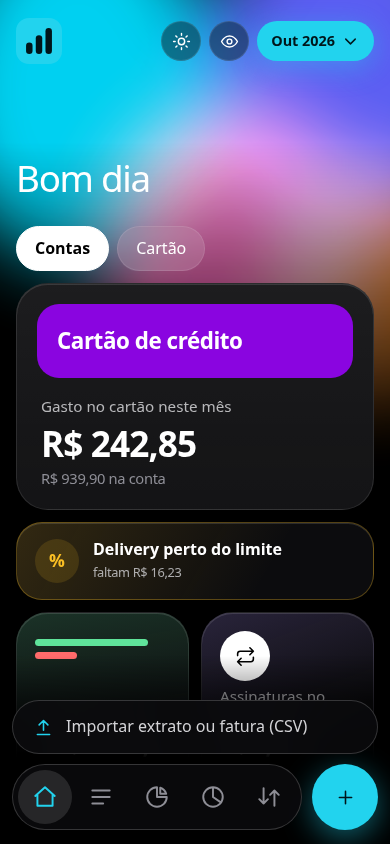<br><b>Início</b>: pendentes, gastos e categorias</td>
<td>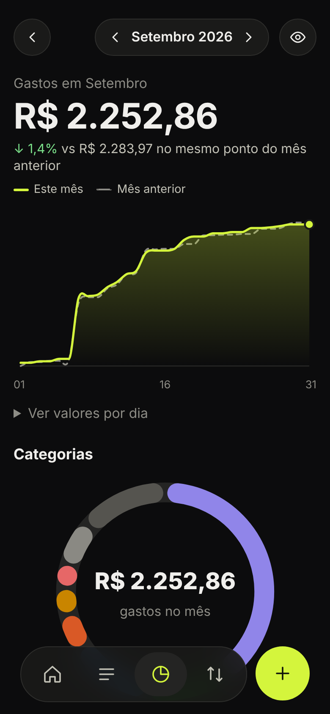<br><b>Gastos</b>: acumulado contra o mês anterior</td>
<td>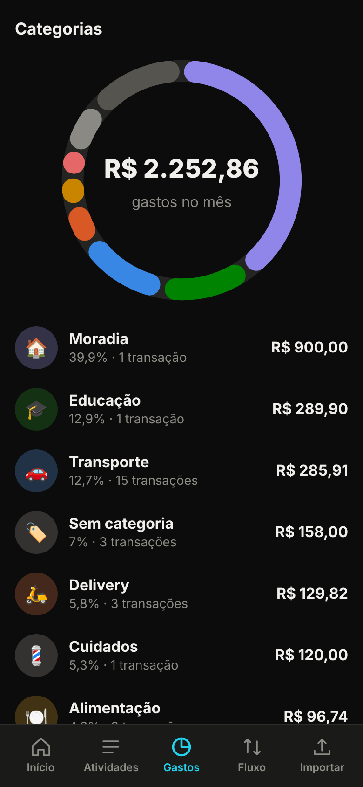<br><b>Categorias</b>: rosca e lista</td>
</tr>
<tr>
<td>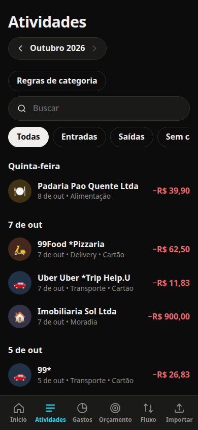<br><b>Atividades</b>: busca, filtros, por dia</td>
<td>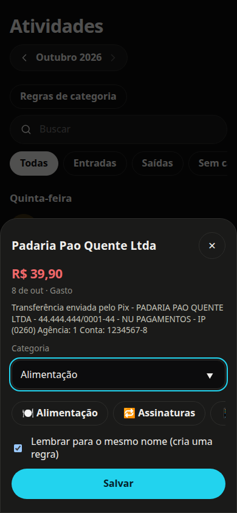<br><b>Categorizar</b>: um toque, com "lembrar"</td>
<td>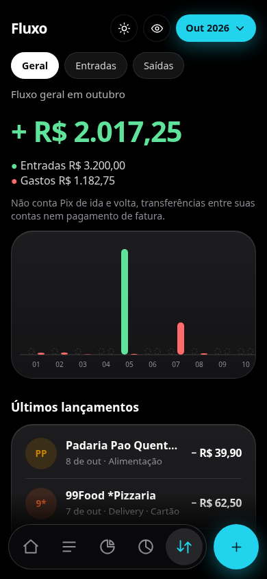<br><b>Fluxo</b>: receitas e gastos por dia</td>
</tr>
<tr>
<td>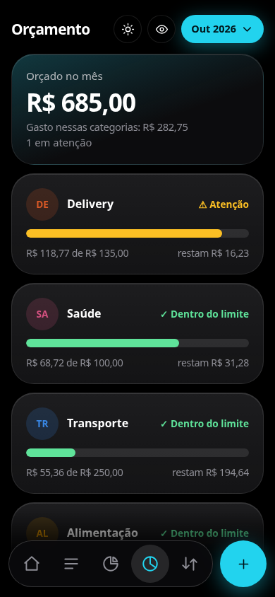<br><b>Orçamento</b>: limite por categoria, com aviso</td>
<td>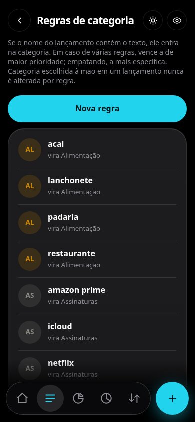<br><b>Regras</b>: criar, editar e apagar</td>
<td></td>
</tr>
</table>

**Tema claro (opcional)**

<table>
<tr>
<td>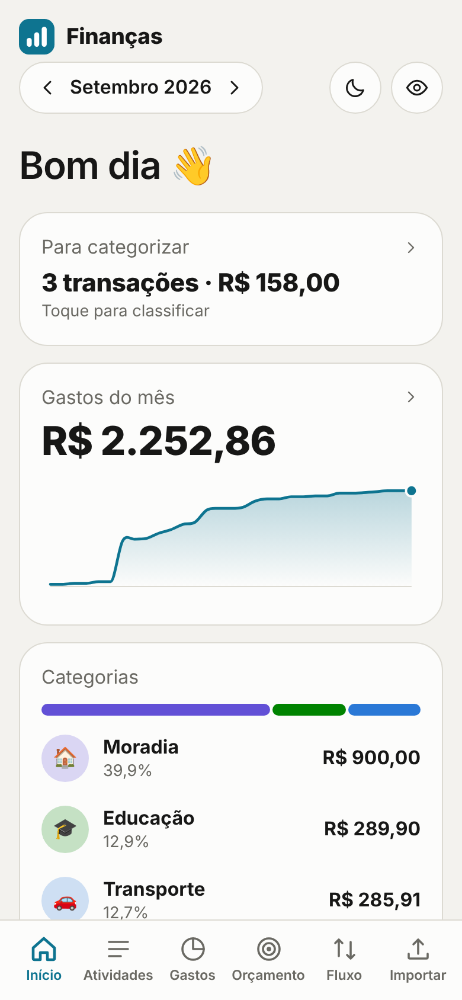</td>
<td>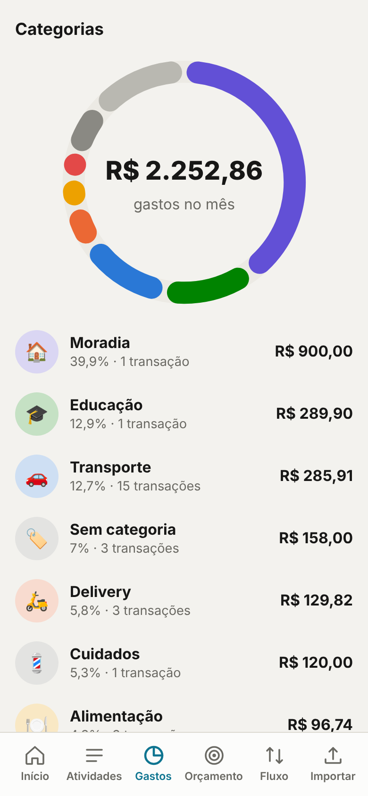</td>
<td>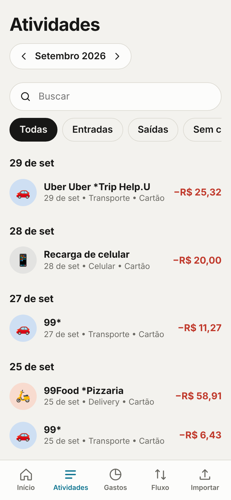</td>
<td>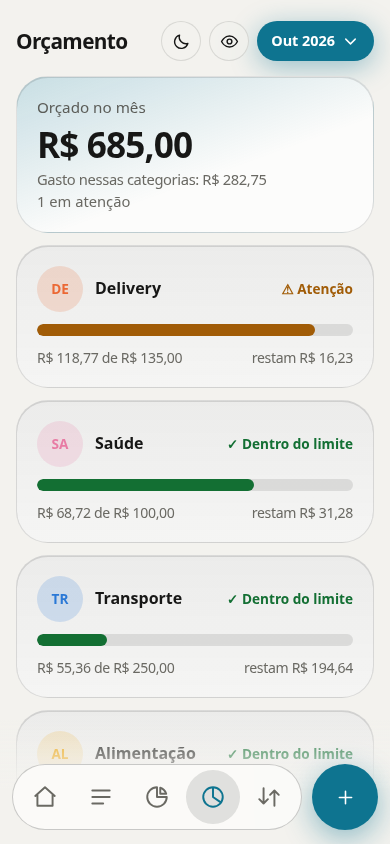</td>
</tr>
</table>

**Computador** (menu lateral e cartões em duas colunas)

<table>
<tr>
<td>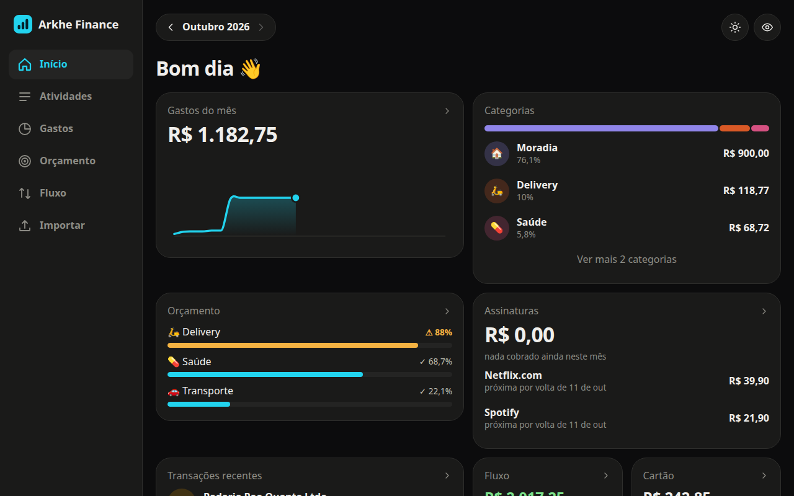</td>
<td>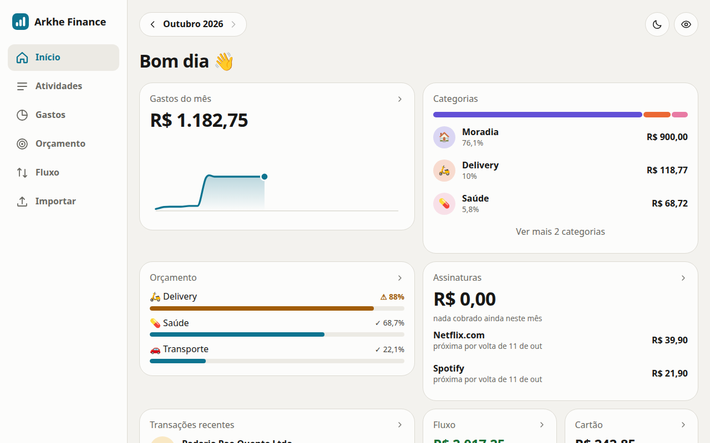</td>
</tr>
<tr>
<td>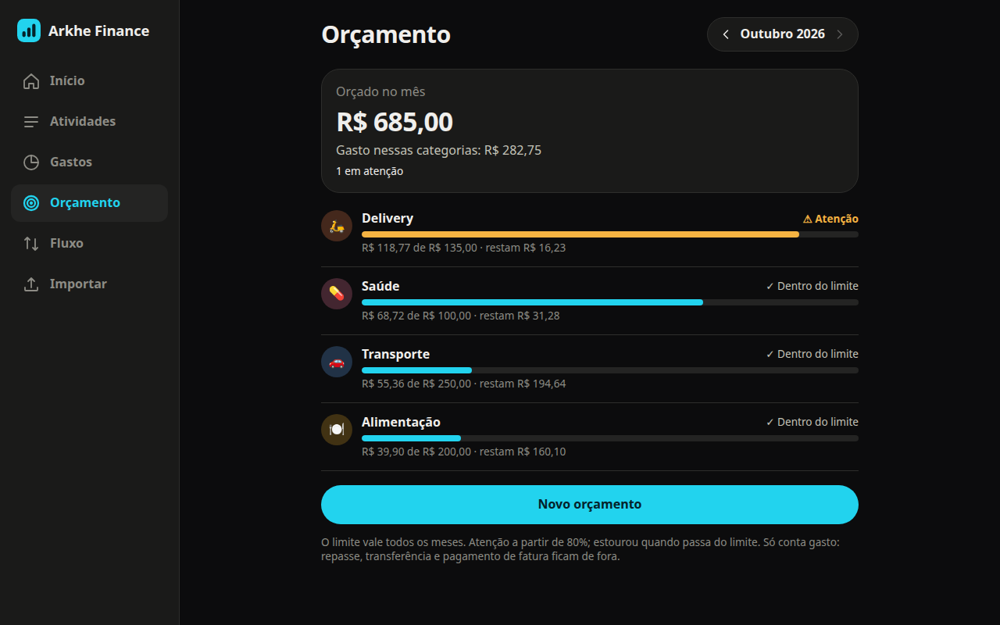</td>
<td></td>
</tr>
</table>

## O problema que o app resolve

Somar tudo que saiu da conta dá um número errado. No extrato real:

- o **pagamento da fatura** repete gastos que já estão na fatura;
- um **Pix entre suas próprias contas** não é gasto nem receita;
- o **Pix no crédito** cria uma entrada que nunca foi dinheiro novo;
- **amigos mandam Pix e você repassa o mesmo valor** — dinheiro que só passou pela conta.

O app classifica cada lançamento em um tipo e só conta como gasto o que é gasto. Isso é o coração do projeto: [`docs/spec/classificacao.md`](docs/spec/classificacao.md).

## Como funciona

```
 CSV da conta ─┐                                ┌─ regras de categoria (+ manual que trava)
               ├─▶ importa ─▶ classifica ─▶ SQLite ─▶ relatórios ─▶ API FastAPI ─▶ app web (PWA)
 CSV da fatura ┘   (idempotente)  (tipo)      local     mensal/diário
```

- **Importar é idempotente:** reimportar, ou importar arquivos que se sobrepõem, não duplica nada.
- **Dinheiro em centavos inteiros**, nunca `float`.
- **Categoria manual trava:** nenhuma regra futura a sobrescreve.
- **Orçamento por categoria:** limite mensal fixo, com aviso a partir de 80% e quando estoura; o estado vai em texto e ícone, não só em cor.
- **Parcelas a vir:** projeta as parcelas restantes de compras parceladas a partir da fatura, sem mexer nos totais de gasto.
- **Assinaturas:** a categoria que o dono define por regra; o app mostra o que foi cobrado no mês e a próxima cobrança estimada.
- **Pix no crédito conta uma vez:** para o próprio dono é transferência; para terceiro vale a linha da fatura, que traz o custo do crédito.
- **Regras editáveis na tela**, com recategorização imediata e sem tocar no que foi categorizado à mão.
- **Interface:** em migração para React + Tailwind (ADR 0021), tela a tela; gráficos em SVG escritos à mão. Enquanto a migração não termina, as telas ainda não migradas seguem em HTML, CSS e JS puros.

## Decisões de engenharia que valem uma olhada

| Tema | Onde ler |
|---|---|
| Chave de duplicata: o identificador do banco **não é único** | [ADR 0003](docs/adr/0003-chave-de-duplicata.md) |
| O que conta (e o que não conta) como gasto | [ADR 0004](docs/adr/0004-tipos-de-lancamento.md) |
| Repasse: pareamento exato e por soma, sem esconder gasto de verdade | [ADR 0005](docs/adr/0005-repasse.md) |
| Categorias por regras, em vez de IA enviando extrato a uma API | [ADR 0006](docs/adr/0006-categorias.md) |
| Repositório público, dados reais fora do git, demonstração fictícia | [ADR 0007](docs/adr/0007-dado-real-fora-do-git.md) |
| Orçamento: limite fixo, aviso a 80%, comparação em centavos sem arredondar | [ADR 0015](docs/adr/0015-orcamento-por-categoria.md), [spec](docs/spec/orcamento.md) |
| Pix no crédito: para si mesmo é transferência; para terceiro conta uma vez, pela fatura | [ADR 0017](docs/adr/0017-pix-no-credito-proprio.md), [0018](docs/adr/0018-pix-no-credito-conta-uma-vez.md) |
| Parcelas futuras como leitura sobre a fatura; assinatura como categoria, sem adivinhar | [ADR 0012](docs/adr/0012-parcelas-futuras.md), [0019](docs/adr/0019-assinaturas-por-categoria.md) |
| Interface em React + Tailwind, cor fixa por categoria (paleta validada para daltonismo), identidade própria e tema claro opcional | [ADR 0021](docs/adr/0021-interface-react-tailwind.md) (revoga o [0009](docs/adr/0009-interface-sem-build.md)), [0010](docs/adr/0010-cor-por-categoria.md), [0014](docs/adr/0014-identidade-visual-e-temas.md) |

Spec diz **o que** o sistema faz (`docs/spec/`); ADR diz **por quê** (`docs/adr/`). **ADR aceito não se edita:** decisão nova revoga a antiga com outro ADR.

## Testes

```bash
pip install -e ".[dev]"
python -m pytest -q
```

Cobrem o importador (os dois formatos), a classificação, o repasse e o Pix no crédito, as regras de categoria, o orçamento, as parcelas, as assinaturas, os relatórios, a API e os dados de demonstração. Cada regra de dinheiro tem teste das leituras possíveis dela. A CI roda a mesma suíte a cada PR.

## Rodando

Requer Python 3.11+.

```bash
./run.sh demo        # app com dados 100% fictícios em http://localhost:8000
```

Com os seus extratos:

```bash
export FINANCAS_OWN_NAMES="SEU NOME COMPLETO"      # suas outras contas (viram transferência)
./run.sh                                           # http://localhost:8000
./run.sh import extrato.csv fatura.csv             # ou use o botão + na tela
```

No celular, abra o endereço no navegador e use "Adicionar à tela inicial". Por enquanto a API **não tem login** e não deve ser exposta na internet (ADR 0008).

## Estrutura

```
src/financas/     importer · classifier · rules · service · parcelas · assinaturas · api · static/ (front antigo)
web/              front novo em React (migração em andamento, ADR 0021)
docs/spec/        o que o sistema faz, por área
docs/adr/         por que cada decisão foi tomada
docs/pendencias.md  fases e o que falta decidir
data/demo/        CSVs fictícios (gerados por scripts/gerar_demo.py)
scripts/          gerar_demo.py · capturas.py (screenshots do README)
tests/            pytest; fixtures fictícias
```

## Sobre os dados deste repositório

Todo dado aqui é **fictício**: nomes, empresas, CNPJ e valores da demonstração e dos testes foram inventados, no formato real do Nubank. Extratos reais ficam em `samples/`, que o git ignora.

## Como foi construído

Projeto solo, com apoio de um assistente de IA (Claude Code) na escrita de código e testes, sob specs e ADRs decididos pelo dono. O processo, sem enfeite, está em [`docs/processo-de-trabalho.md`](docs/processo-de-trabalho.md).
